# MeetingMind AI

**Turn meeting transcripts into summaries, action items, confirmed owners, and calendar-synced tasks.**


| | |
|---|---|
| **Live app** | https://meetingmind-frontend.vercel.app |
| **Stack** | Next.js 15 · React 19 · TypeScript · Node.js · Express 5 · MongoDB Atlas |
| **AI** | Google Gemini (extraction, chat) · Jev AI (confidence scoring) |
| **Integrations** | Google Sign-In · Google Tasks · Google Calendar |
| **License** | MIT |

---

## Table of Contents

- [Overview](#overview)
- [Use Cases](#use-cases)
- [Key Features](#key-features)
- [Workflow](#workflow)
- [Architecture](#architecture)
- [Tech Stack](#tech-stack)
- [Security](#security)
- [Google Integration](#google-integration)
- [Project Structure](#project-structure)
- [Getting Started](#getting-started)
- [Deployment](#deployment)
- [Roadmap](#roadmap)
- [License](#license)

---

## Overview

Meetings produce decisions and commitments, but follow-ups are often lost. Nobody is sure who owns a task or when it is due. MeetingMind reads a transcript, extracts structured action items, checks how confident it is about each one, asks the user to resolve anything unclear, and then syncs the final list to Google Calendar and Google Tasks.

The key idea is **confidence-gated automation**: every task gets a score, and anything below **0.7** goes to a person before it is trusted.

---

## Use Cases

| Who | Situation | What MeetingMind does |
|---|---|---|
| Project managers | Weekly status meetings generate 10+ follow-ups | Extracts every task with owner and deadline in one pass |
| Engineering teams | Sprint planning and standups | Turns decisions into dated tasks in Google Calendar |
| Students and student teams | Group project meetings | Assigns owners and reminders so nothing slips |
| Consultants and clients | Client calls with long transcripts | Produces a shareable PDF of commitments |
| Executives | Back-to-back meetings | Gives a summary and a chat box to ask "what did we decide about X?" |
| Operations and HR | Recurring reviews and onboarding calls | Keeps an auditable history of meetings and task status |

### Example

**Input transcript excerpt:**

> Sarah: We need the Redis patches deployed by Friday.
> Marcus: I'll take that.
> John: What about the database migration?
> Sarah: That's next sprint, we'll decide later.

**MeetingMind output:**

| Task | Owner | Deadline | Confidence | Status |
|---|---|---|---|---|
| Deploy Redis patches | Marcus Vance | Friday (ISO date) | 0.85 | Accepted |
| Database migration | Unassigned | Next sprint | 0.30 | Asks user to clarify owner |

---

## Key Features

- **Transcript upload** for PDF and TXT files (up to 50 MB)
- **Automatic extraction** of meeting title, date, summary, and tasks
- **Owner and deadline scoring** for every task
- **Clarification loop** that asks the user about low-confidence tasks
- **Inline editing** of owner, deadline, priority, and status
- **Dashboard** with meeting history and stats
- **Follow-up chat** scoped to a single meeting
- **PDF export** of a meeting's task list
- **Google sync** to Calendar (with reminders) and Tasks
- **Encrypted storage** of transcripts with AES-256-GCM

---

## Workflow

### End-to-end user journey

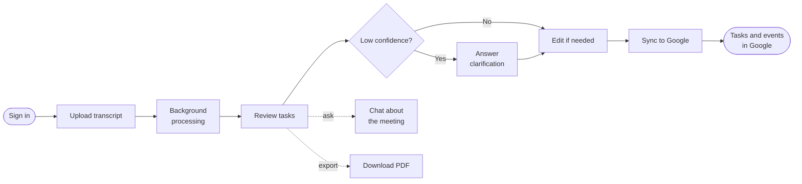

### Processing pipeline

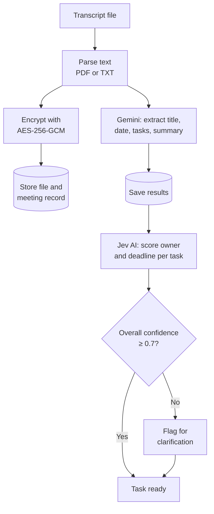

### Meeting status lifecycle

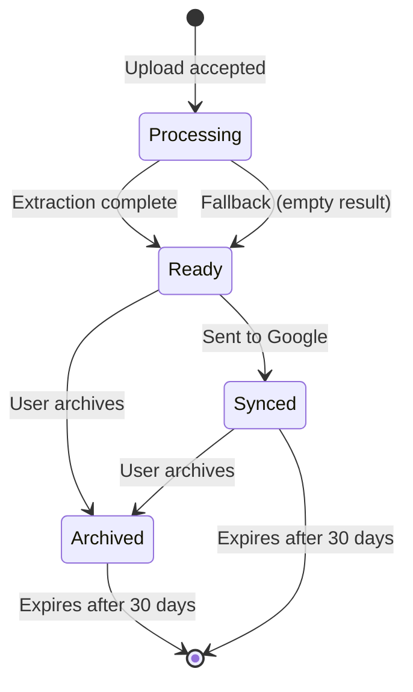

Failed extractions move to **Ready** with an empty task list and a message asking the user to re-upload, so the screen never gets stuck on "processing."

---

## Architecture

### System context

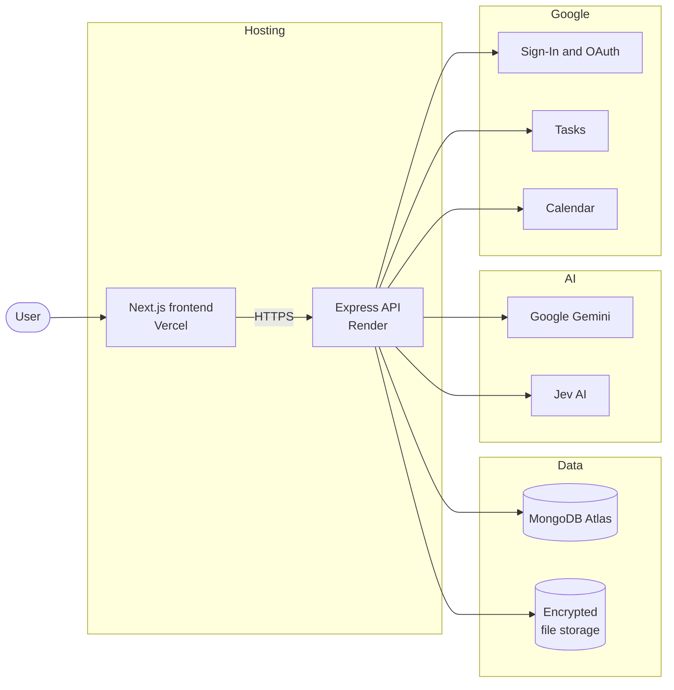

### Components

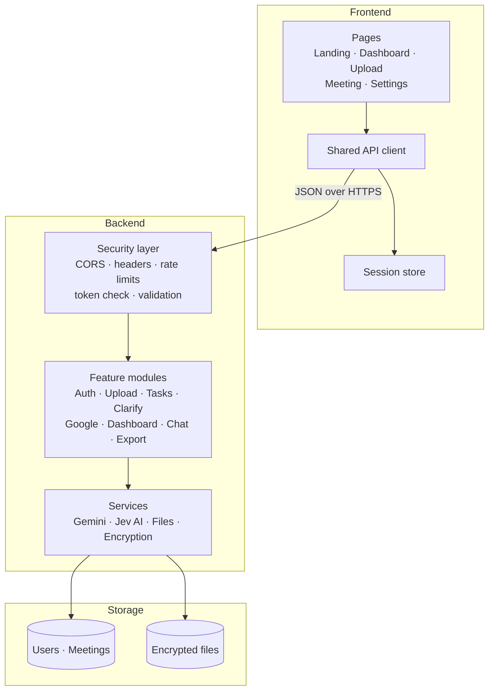

### Backend request handling

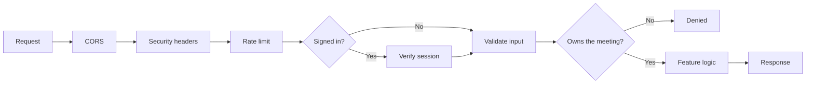

### Dual-AI design

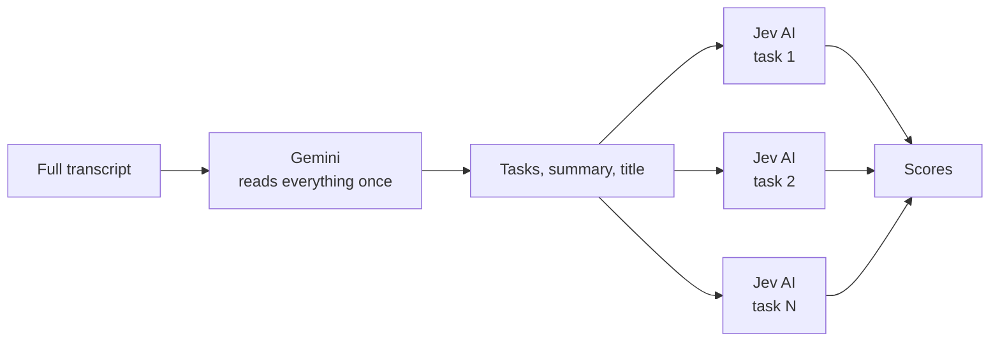

| | Gemini | Jev AI |
|---|---|---|
| Job | Extract structure and summary | Score confidence |
| Input | Whole transcript | One short task |
| Why | Needs full context once | Cheap, fast, repeated per task |

### Confidence and clarification

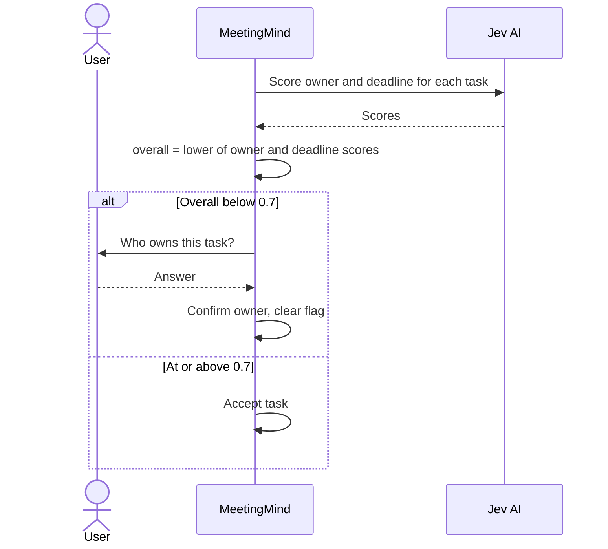

### Resilience

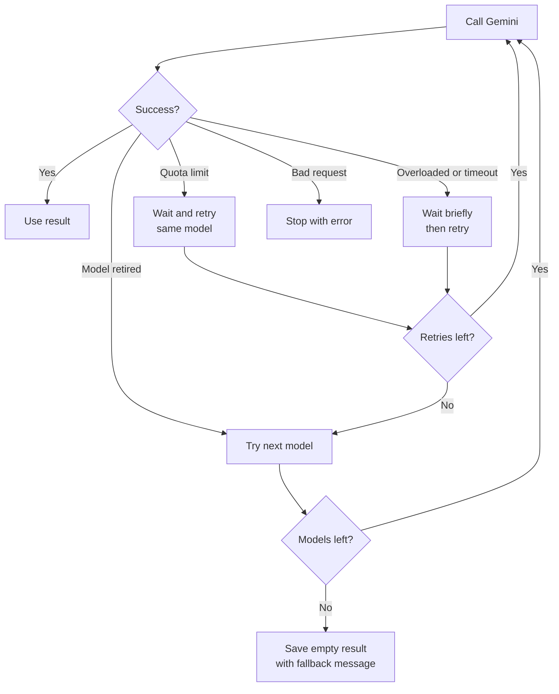

The model order is `gemini-3.5-flash-lite`, then `gemini-3.5-flash`, then `gemini-3.6-flash`.

---

## Tech Stack

| Layer | Technology | Role |
|---|---|---|
| Frontend framework | Next.js 15 (App Router) | Pages and routing |
| UI library | React 19 | Components |
| Language | TypeScript | Type safety |
| Styling | Tailwind CSS, custom theme | Layout and design |
| Motion | Framer Motion | Transitions |
| Client state | Zustand | Session state |
| Backend runtime | Node.js 18+ | Server |
| Web framework | Express 5 | HTTP API |
| Database | MongoDB Atlas | Users, meetings, tasks |
| AI extraction | Google Gemini | Tasks, summary, chat |
| AI scoring | Jev AI | Confidence scores |
| Authentication | JWT (7-day), bcrypt (12 rounds), Google OAuth 2.0 | Identity |
| Security middleware | Helmet, express-rate-limit, Joi | Headers, abuse control, validation |
| Encryption | AES-256-GCM | Transcripts at rest |
| Files | multer, pdf-parse, PDFKit | Upload, parsing, export |
| Google APIs | Tasks, Calendar | Syncing |
| Hosting | Vercel (frontend), Render (backend), MongoDB Atlas | Deployment |

---

## Security

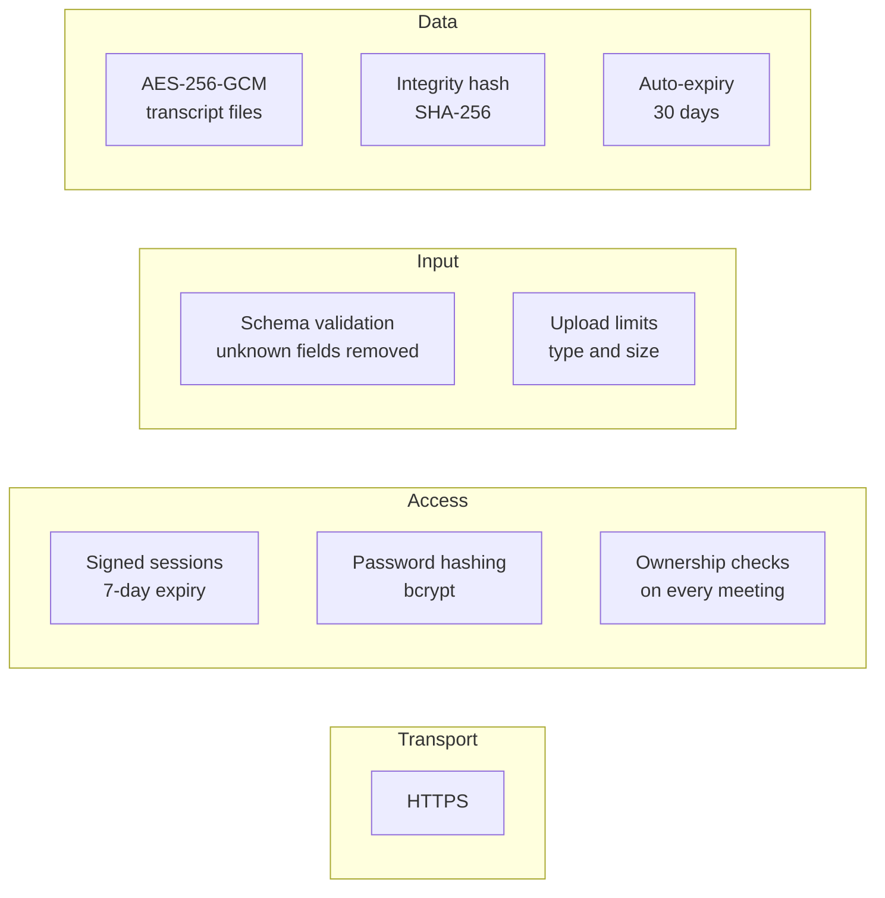

| Control | Detail |
|---|---|
| Passwords | bcrypt with 12 salt rounds |
| Sessions | JWT signed with a secret, expires after 7 days |
| Access control | Users can only read or change their own meetings |
| Transcript storage | AES-256-GCM, random IV per file, tamper detection |
| Headers | Helmet: content security policy, HSTS, frame protection |
| Abuse control | 1,000 requests per 15 minutes; 100 uploads per hour |
| Input | Schema validation; unexpected fields dropped |
| CORS | Limited to the app's own origins |

**Known limitations:** tokens cannot be revoked before they expire, and meeting metadata and task text are stored unencrypted in the database. Only transcript files are encrypted.

---

## Google Integration

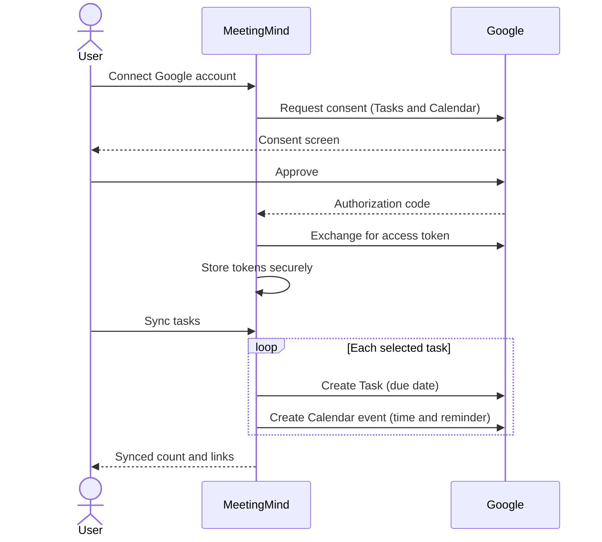

| Google service | What it receives | Why |
|---|---|---|
| Tasks | Due date only | Tasks has no time field, so the time is dropped |
| Calendar | Date, time, and reminder (default 60 minutes before) | Full scheduling |

**Choosing what to sync:** tasks selected by the user are synced. If none are selected, tasks assigned to the signed-in user's name are synced. If no tasks match, the user chooses manually.

---

## Project Structure

```
meetingmind/
├── frontend/          Next.js app: pages, components, API client, types
├── backend/           Express API: routes, services, models, middleware, utils
├── docs/              Architecture, data model, deployment, and source reports
├── README.md
├── LICENSE
└── .gitignore
```

---

## Getting Started

### Prerequisites

- Node.js 18 or newer
- A MongoDB Atlas cluster (or local MongoDB)
- Google Gemini and Jev AI API keys
- A Google Cloud OAuth client with the Tasks and Calendar APIs enabled

### Run locally

```bash
# Backend
cd backend
npm install
cp ../.env.example .env      # fill in your values
npm start                    # runs on http://localhost:3001

# Frontend (in a second terminal)
cd frontend
npm install
echo "NEXT_PUBLIC_API_URL=http://localhost:3001" > .env.local
npm run dev                  # runs on http://localhost:3000
```

### Generate an encryption key

```bash
node -e "console.log(require('crypto').randomBytes(32).toString('hex'))"
```

Keep all keys and secrets in `.env` files. Never commit them.

---

## Deployment

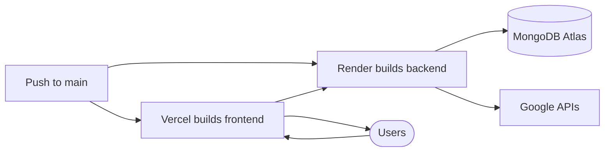

| Part | Host | Notes |
|---|---|---|
| Frontend | Vercel | Root directory `frontend`; set the backend URL |
| Backend | Render | Web service; health check on `/health` |
| Database | MongoDB Atlas | Allow access from the backend host |
| OAuth | Google Cloud | Add the app's callback and origin URLs |

---

## Roadmap

- [ ] Automated tests
- [ ] Background job queue for retries
- [ ] Multi-language transcripts
- [ ] Shared team workspaces
- [ ] Live transcription

---

## License

Released under the [MIT License](LICENSE).
