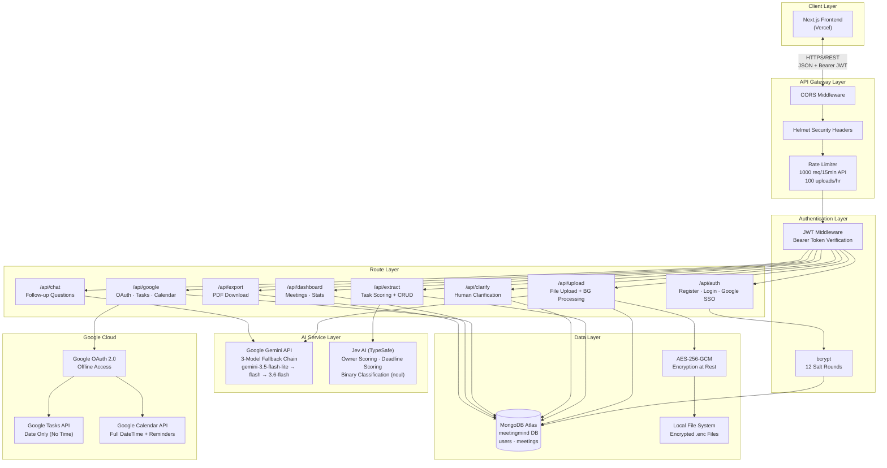
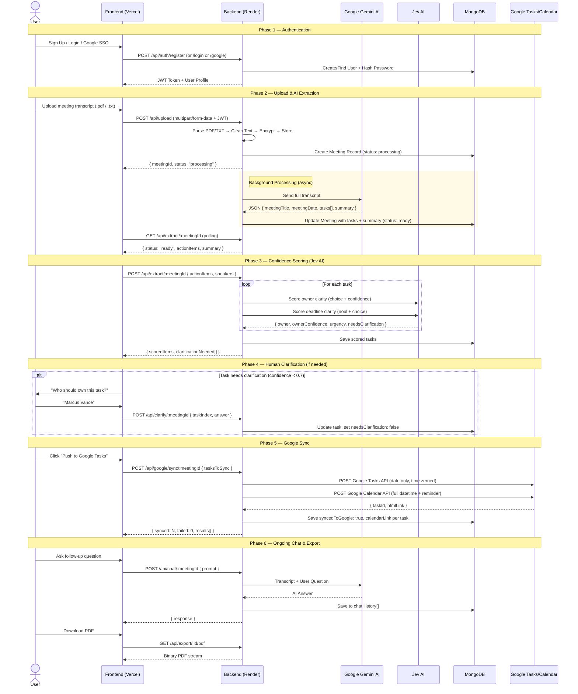
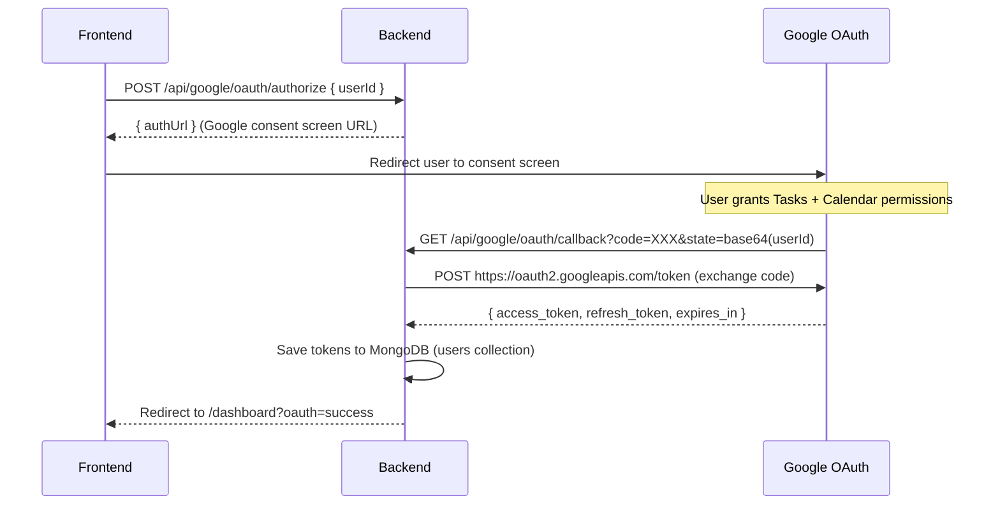

# 🧠 MeetingMind AI — Backend Architecture & System Design Report

> **Version:** 1.0.0 · **Author:** Prince S · **Last Updated:** September 2026
> 
> A production-grade, AI-powered meeting transcript analysis platform that extracts action items, assigns owners, scores confidence, syncs tasks to Google, and enables conversational follow-up — all through a secure REST API.

---

## Table of Contents

1. [Tech Stack Overview](#1-tech-stack-overview)
2. [Project File Structure](#2-project-file-structure)
3. [System Architecture Diagram](#3-system-architecture-diagram)
4. [Complete API Endpoints Reference](#4-complete-api-endpoints-reference)
5. [End-to-End Workflow Diagram](#5-end-to-end-workflow-diagram)
6. [Dual-AI Model Architecture (Gemini + Jev AI)](#6-dual-ai-model-architecture-gemini--jev-ai)
7. [API Rate Limit Handling & Fallback Strategy](#7-api-rate-limit-handling--fallback-strategy)
8. [Security Implementation](#8-security-implementation)
9. [Google Integration (OAuth, Tasks, Calendar)](#9-google-integration-oauth-tasks-calendar)
10. [Error Handling Strategy](#10-error-handling-strategy)
11. [Frontend-Backend Communication](#11-frontend-backend-communication)
12. [Deployment on Render](#12-deployment-on-render)
13. [Database Schema (MongoDB)](#13-database-schema-mongodb)
14. [Environment Variables](#14-environment-variables)

---

## 1. Tech Stack Overview

| Layer | Technology | Version | Purpose |
|---|---|---|---|
| **Runtime** | Node.js | v18+ | Server-side JavaScript execution |
| **Framework** | Express.js | v5.2.1 | HTTP routing, middleware pipeline |
| **Database** | MongoDB | v7.6.0 (Driver) | Document storage for users, meetings, tasks |
| **AI — Primary** | Google Gemini API | gemini-3.5-flash-lite / flash / 3.6-flash | Transcript parsing, task extraction, summary, chat |
| **AI — Scorer** | Jev AI (TypeSafe) | jev-latest | Confidence scoring, owner/deadline classification |
| **Auth** | JSON Web Tokens | v9.0.3 | Stateless session management |
| **Password Security** | bcrypt | v6.0.0 | Password hashing (12 salt rounds) |
| **Encryption** | Node.js `crypto` | Built-in | AES-256-GCM encryption at rest |
| **Validation** | Joi | v18.2.9 | Request payload schema validation |
| **File Upload** | multer | v2.4.0 | Multipart file processing (PDF, TXT) |
| **PDF Generation** | PDFKit | v0.20.2 | Server-side PDF export of tasks |
| **PDF Parsing** | pdf-parse | v2.4.5 | Extract text content from uploaded PDFs |
| **Security Headers** | Helmet | v8.3.0 | HTTP security headers (XSS, CSP, etc.) |
| **Rate Limiting** | express-rate-limit | v8.7.0 | DDoS/abuse prevention |
| **HTTP Client** | axios | v1.20.0 | External API calls (Google, Jev AI, Gemini) |
| **CORS** | cors | v2.8.6 | Cross-origin resource sharing for frontend |
| **Dev Server** | nodemon | v3.1.14 | Auto-restart on file changes during development |
| **Hosting** | Render | — | Cloud deployment (Web Service) |

---

## 2. Project File Structure

```
meetingmind-backend/
├── package.json                    # Dependencies & scripts
├── README.md                       # This document
├── src/
│   ├── server.js                   # ★ Entry point: Express app, MongoDB, routes
│   │
│   ├── config/                     # Environment configuration
│   │
│   ├── middleware/
│   │   ├── authenticate.js         # JWT verification & token generation
│   │   ├── error-handler.js        # Global error handler + asyncHandler wrapper
│   │   ├── security.js             # Rate limiters (API + Upload)
│   │   └── validation.js           # Joi schemas for input validation
│   │
│   ├── models/
│   │   ├── Meeting.js              # Meeting CRUD, task management, sync status
│   │   └── User.js                 # User CRUD, Google token storage
│   │
│   ├── routes/
│   │   ├── auth.js                 # Register, Login, Google Sign-In
│   │   ├── upload.js               # File upload + background AI extraction
│   │   ├── extract.js              # Task clarity scoring + CRUD on tasks
│   │   ├── clarify.js              # Human-in-the-loop clarification answers
│   │   ├── google-sync.js          # OAuth flow, Tasks API, Calendar API sync
│   │   ├── dashboard.js            # Meeting list, stats, delete
│   │   ├── chat.js                 # Conversational follow-up with Gemini
│   │   └── export.js               # PDF generation and download
│   │
│   ├── services/
│   │   ├── gemini.js               # Google Gemini API with multi-model fallback
│   │   ├── jev-ai.js               # Jev AI confidence scoring service
│   │   └── file-handler.js         # PDF/TXT parsing, encryption, storage
│   │
│   └── utils/
│       ├── encryption.js           # AES-256-GCM encrypt/decrypt + SHA-256 hashing
│       └── dateParser.js           # Abstract urgency → concrete Date mapping
│
└── uploads/                        # Encrypted file storage (local)
```

---

## 3. System Architecture Diagram



---

## 4. Complete API Endpoints Reference

### 🔐 Authentication (`/api/auth`)

| Method | Endpoint | Auth | Description |
|---|---|---|---|
| `POST` | `/api/auth/register` | ✗ | Register with email, name, password |
| `POST` | `/api/auth/login` | ✗ | Login with email + password |
| `POST` | `/api/auth/google` | ✗ | Google Sign-In (exchange auth code) |

### 📤 Upload (`/api/upload`)

| Method | Endpoint | Auth | Description |
|---|---|---|---|
| `POST` | `/api/upload` | ✓ | Upload PDF/TXT transcript. Triggers background AI extraction. Returns `meetingId` immediately. |

### 🔍 Extract (`/api/extract`)

| Method | Endpoint | Auth | Description |
|---|---|---|---|
| `GET` | `/api/extract/:meetingId` | ✓ | Poll extraction status (processing → ready → synced) |
| `POST` | `/api/extract/:meetingId` | ✓ | Run Jev AI clarity scoring on extracted tasks |
| `PATCH` | `/api/extract/:meetingId/tasks/:taskIndex` | ✓ | Update a specific task (owner, deadline, status) |
| `DELETE` | `/api/extract/:meetingId/tasks/:taskIndex` | ✓ | Delete a specific task |

### ❓ Clarify (`/api/clarify`)

| Method | Endpoint | Auth | Description |
|---|---|---|---|
| `GET` | `/api/clarify/:meetingId` | ✓ | Get all tasks needing clarification |
| `POST` | `/api/clarify/:meetingId` | ✓ | Submit human clarification answer |

### 🔗 Google Integration (`/api/google`)

| Method | Endpoint | Auth | Description |
|---|---|---|---|
| `GET` | `/api/google/status` | ✓ | Check if user has valid Google OAuth tokens |
| `POST` | `/api/google/oauth/authorize` | ✗ | Get Google OAuth consent URL |
| `GET` | `/api/google/oauth/callback` | ✗ | Handle OAuth redirect, exchange code for tokens |
| `POST` | `/api/google/sync/:meetingId` | ✓ | Sync tasks to Google Tasks + Calendar |

### 📊 Dashboard (`/api/dashboard`)

| Method | Endpoint | Auth | Description |
|---|---|---|---|
| `GET` | `/api/dashboard/meetings` | ✓ | List all user meetings (paginated) |
| `GET` | `/api/dashboard/stats` | ✓ | Get aggregate stats (total meetings, tasks, sync count) |
| `DELETE` | `/api/dashboard/:meetingId` | ✓ | Delete a meeting and all its data |

### 💬 Chat (`/api/chat`)

| Method | Endpoint | Auth | Description |
|---|---|---|---|
| `POST` | `/api/chat/:meetingId` | ✓ | Ask a follow-up question about the meeting |
| `GET` | `/api/chat/:meetingId/history` | ✓ | Get all past Q&A history for a meeting |

### 📄 Export (`/api/export`)

| Method | Endpoint | Auth | Description |
|---|---|---|---|
| `GET` | `/api/export/:id/pdf` | ✓ | Download meeting tasks as a formatted PDF |

---

## 5. End-to-End Workflow Diagram



---

## 6. Dual-AI Model Architecture (Gemini + Jev AI)

### Why Two AI Models?

MeetingMind uses a **"Extract → Score → Clarify"** pipeline that separates concerns across two specialized AI systems:

| Dimension | Google Gemini | Jev AI (TypeSafe) |
|---|---|---|
| **Role** | Heavy-duty extraction & generation | Precision confidence scoring |
| **Input Size** | Full transcript (thousands of tokens) | Single task string (~50 tokens) |
| **Output** | Structured JSON (tasks, summary, dates) | Numeric scores + classifications |
| **Temperature** | 0.1 (deterministic extraction) | N/A (classification model) |
| **Cost Profile** | Higher (large context window) | Lower (small payload per call) |
| **Fallback** | 3-model cascade + 3 retries each | Error → `needsClarification: true` |

### Google Gemini — What It Does

1. **`extractTasksAndSummary(transcript)`** — The core function. Sends the entire transcript to Gemini with a system prompt that enforces strict JSON output containing:
   - `meetingTitle` — Auto-generated descriptive title
   - `meetingDate` — Inferred from context
   - `tasks[]` — Each with `task`, `owner`, `deadline`, `deadlineISO`, `reminderISO`, `reminderNote`, `priority`, `status`
   - `summary` — 2-3 sentence meeting summary

2. **`analyzeWithPrompt(transcript, userPrompt)`** — Powers the Chat feature. Sends the transcript + a user's follow-up question (e.g., "What did Sarah say about the budget?"). Temperature is set to `0.7` for more natural, conversational responses.

3. **`generateClarificationQuestion(task, ambiguity)`** — Generates human-friendly clarification questions when a task is ambiguous (e.g., "Who should handle the Redis deployment?").

### Jev AI — What It Does

Jev AI operates on the `jev-latest` model via the TypeSafe SystemOne API. It provides three scoring functions:

1. **`scoreOwnerClarity(task, speakers[])`**
   - Uses `choice` type: picks the most likely owner from the speaker list
   - Uses `score` type: rates confidence (0.0–1.0) on a 3-point scale (Not sure → Very sure)
   - Returns `ownerProbabilities` — probability distribution across all possible owners

2. **`scoreDeadlineClarity(task)`**
   - Uses `noul` type: binary classification — "Is there a clear deadline?" (threshold: 0.5)
   - Uses `choice` type: classifies urgency into `ASAP` / `This Week` / `This Month` / `No specific deadline`

3. **`scoreTaskClarity(task, speakers[])`** — Combines both in parallel via `Promise.all()` and computes an `overallConfidence` score. If either dimension scores below `0.7`, the task is flagged with `needsClarification: true`.

---

## 7. API Rate Limit Handling & Fallback Strategy

### Express Rate Limiting (Inbound)

```
API Limiter:    1,000 requests per 15-minute window
Upload Limiter: 100 uploads per 1-hour window (skips successful requests)
```

### Gemini Multi-Model Fallback Chain (Outbound)

The `geminiPost()` function implements a sophisticated retry cascade:

```
Model Chain:  gemini-3.5-flash-lite → gemini-3.5-flash → gemini-3.6-flash
Retries:      3 attempts per model (9 total maximum attempts)
```

| HTTP Status | Behavior |
|---|---|
| **429** (Quota Exceeded) | Wait 15 seconds, retry same model. After 3 failures, throw immediately (quota is account-wide). |
| **503** (Overloaded) | Wait 5 seconds, retry same model. After 3 failures, cascade to next model. |
| **Timeout** (ECONNABORTED) | Same as 503 — retry, then cascade. |
| **404** (Deprecated Model) | Skip immediately to next model in chain. |
| **400** (Bad Request) | Throw immediately — no retry (indicates a code bug). |
| **All models exhausted** | Throw the last captured error to the caller. |

### Graceful Degradation

If the entire Gemini extraction pipeline fails, the `upload.js` background task catches the error and writes fallback data to MongoDB:
- `extracted: []` (empty tasks array)
- `summary: "Processing failed. Please try uploading again."`

This ensures the frontend never gets stuck in a permanent "processing" state.

---

## 8. Security Implementation

### Layer 1 — HTTP Security (Helmet)

Applied globally via `app.use(helmet())`. Sets security headers including:
- `X-Content-Type-Options: nosniff`
- `X-Frame-Options: DENY`
- `Strict-Transport-Security` (HSTS)
- `Content-Security-Policy`

### Layer 2 — Authentication (JWT + bcrypt)

- **Password Hashing:** `bcrypt` with **12 salt rounds** — computationally expensive enough to resist brute-force attacks.
- **Token Generation:** JWT signed with `process.env.JWT_SECRET`, expires in **7 days**.
- **Token Verification:** `authenticate` middleware extracts `userId` and `email` from the token and injects them into `req.userId` / `req.userEmail`.
- **Error Differentiation:** Separately handles `TokenExpiredError` vs `JsonWebTokenError` for clear frontend messaging.

### Layer 3 — Encryption at Rest (AES-256-GCM)

```
Algorithm:    AES-256-GCM (Authenticated Encryption)
Key:          32-byte key from ENCRYPTION_KEY env variable
IV:           16-byte random Initialization Vector (per encryption)
Auth Tag:     16-byte GCM authentication tag (tamper detection)
Storage:      iv (hex) + authTag (hex) + ciphertext (hex)
```

- **What is encrypted:** Uploaded transcript content before writing to the local filesystem as `.enc` files.
- **File Integrity:** SHA-256 hash (`hashFile()`) is computed on the raw file buffer and stored in MongoDB for deduplication and integrity verification.
- **Why GCM:** Unlike CBC, GCM provides both confidentiality AND authenticity. If an attacker modifies the ciphertext, decryption will fail (the auth tag won't match).

### Layer 4 — Input Validation (Joi)

- `fileUploadSchema`: Validates file name (max 255 chars), type (txt/pdf only), size (max 50MB).
- `taskCreationSchema`: Validates task string (max 500 chars), priority enum, confidence range.
- `validateInput` middleware strips unknown fields (`stripUnknown: true`) to prevent injection.

### Layer 5 — Authorization (Per-Resource)

Every route that accesses a meeting checks `meeting.userId.toString() !== req.userId` and returns `403 Forbidden` if the authenticated user does not own the resource.

---

## 9. Google Integration (OAuth, Tasks, Calendar)

### OAuth 2.0 Flow



**Scopes Requested:**
- `https://www.googleapis.com/auth/tasks` — Create/manage tasks
- `https://www.googleapis.com/auth/calendar` — Create calendar events

**Access Type:** `offline` — Ensures a `refresh_token` is returned for long-lived access.

### Google Tasks API

- **Endpoint:** `https://www.googleapis.com/tasks/v1/lists/@default/tasks`
- **Critical Limitation:** The Tasks API **only accepts dates, not times**. The `due` field discards any time information.
- **Our Workaround:** Before sending to Tasks, the backend zeros out the time: `taskDate.setUTCHours(0, 0, 0, 0)`.
- **Payload:**
  ```json
  {
    "title": "Deploy Redis patches",
    "notes": "Owner: Marcus Vance\nPriority: HIGH\nSource: MeetingMind AI",
    "due": "2026-09-27T00:00:00.000Z"
  }
  ```

### Google Calendar API

- **Endpoint:** `https://www.googleapis.com/calendar/v3/calendars/primary/events`
- **Full DateTime Support:** Calendar preserves the exact time selected by the user.
- **Reminder:** A popup reminder is set for the user-specified offset (default: 60 minutes before).
- **HTML Link:** The `htmlLink` from the Calendar response is saved to MongoDB, enabling the frontend to redirect users to edit the event time directly in Google Calendar.
- **Payload:**
  ```json
  {
    "summary": "[TASK] Deploy Redis patches",
    "description": "Owner: Marcus Vance\nSource: MeetingMind AI",
    "start": { "dateTime": "2026-09-27T14:22:00.000Z", "timeZone": "UTC" },
    "end":   { "dateTime": "2026-09-27T15:22:00.000Z", "timeZone": "UTC" },
    "reminders": {
      "useDefault": false,
      "overrides": [{ "method": "popup", "minutes": 60 }]
    }
  }
  ```

### Smart Task Assignment Logic

When syncing, the backend implements auto-matching:
1. If `tasksToSync[]` is provided by the frontend → use those directly.
2. Otherwise, auto-filter tasks where the `owner` name matches the logged-in user's name.
3. If zero matches → return `{ requiresManualSelection: true, allTasks }` to prompt the frontend.

### Per-Task Sync Status

After syncing, each action item in the `actionItems[]` array is updated with:
- `syncedToGoogle: true` — Frontend displays "Task Synced" ✅
- `googleTaskId: "..."` — The Google Tasks API ID
- `calendarLink: "https://calendar.google.com/..."` — Direct link to edit the event

---

## 10. Error Handling Strategy

### Global Error Handler (`error-handler.js`)

```javascript
// asyncHandler wraps every route handler to catch async errors
export const asyncHandler = (fn) => (req, res, next) => {
    Promise.resolve(fn(req, res, next)).catch(next);
};
```

The global `errorHandler` middleware differentiates error types:

| Error Type | HTTP Status | Response |
|---|---|---|
| `ValidationError` | 400 | `{ error: "Validation failed", details }` |
| `UnauthorizedError` | 401 | `{ error: "Unauthorized" }` |
| `NotFoundError` | 404 | `{ error: "Not found" }` |
| `TokenExpiredError` | 401 | `{ error: "Token expired. Please log in again." }` |
| `JsonWebTokenError` | 401 | `{ error: "Invalid token. Please log in again." }` |
| Unhandled | 500 | `{ error: "Internal server error" }` |

### Per-Task Error Isolation (Google Sync)

During sync, each task is wrapped in its own `try/catch`. If one task fails (e.g., Google returns 403), the loop continues processing remaining tasks. The response reports both `synced` and `failed` counts.

### AI Extraction Failsafe

If the background Gemini extraction crashes, the upload route writes empty results and a fallback summary to MongoDB so the UI never hangs on "processing" indefinitely.

---

## 11. Frontend-Backend Communication

| Aspect | Implementation |
|---|---|
| **Protocol** | HTTPS REST (JSON payloads) |
| **Authentication** | Every request includes `Authorization: Bearer <JWT>` header |
| **CORS Origins** | Frontend URL (from env), localhost:3000-3003 |
| **Request Size Limit** | 10MB (JSON body), 50MB (file upload) |
| **Response Contract** | All endpoints return `{ success: boolean, ...data }` |
| **Polling Pattern** | Frontend polls `GET /api/extract/:id` until `status !== "processing"` |
| **State Persistence** | All state (tasks, sync status, chat history) is stored in MongoDB. Frontend can reconstruct any page from a single GET request. |

### Data Flow: Frontend → Backend → Frontend

```
Frontend sends:     { tasksToSync: [{ task, owner, deadlineISO, priority }] }
Backend processes:  Parse dates → Create Google Task → Create Calendar Event → Save to DB
Backend returns:    { success: true, synced: 3, failed: 0, results: [{ task, googleTaskId, calendarLink }] }
Frontend renders:   ✅ Green checkmark + "Task Synced" badge + "Edit in Google" button
```

---

## 12. Deployment on Render

### Configuration

| Setting | Value |
|---|---|
| **Service Type** | Web Service |
| **Build Command** | `npm install` |
| **Start Command** | `node src/server.js` |
| **Root Directory** | `/` |
| **Environment** | Node |
| **Branch** | `main` |
| **Auto-Deploy** | On push to `main` |

### Environment Variables (Render Dashboard)

All sensitive configuration is stored as Render environment variables (never committed to Git):

- `MONGODB_URI` — MongoDB Atlas connection string
- `JWT_SECRET` — Secret for signing JWTs
- `ENCRYPTION_KEY` — 32-byte hex key for AES-256-GCM
- `GEMINI_API_KEY` — Google AI Studio API key
- `JEV_API_KEY` — Jev AI (TypeSafe) API key
- `GOOGLE_CLIENT_ID` — Google OAuth client ID
- `GOOGLE_CLIENT_SECRET` — Google OAuth client secret
- `GOOGLE_REDIRECT_URL` — OAuth callback URL
- `FRONTEND_URL` — Vercel frontend URL (for CORS + redirects)

### Health Check

Render pings `GET /health` which returns `{ status: "ok", timestamp }` to verify the service is running.

### DNS Resolution

The server explicitly sets Google's DNS servers (`8.8.8.8`, `8.8.4.4`) at startup to avoid Render's internal DNS resolution issues with external API calls.

---

## 13. Database Schema (MongoDB)

### `users` Collection

```javascript
{
  _id: ObjectId,
  email: String,            // Unique index
  name: String,
  password: String | null,  // bcrypt hash (null for Google SSO users)
  authProvider: "local" | "google",
  googleId: String | null,
  profilePicture: String | null,
  googleTokens: {
    accessToken: String,
    refreshToken: String,
    expiresAt: Number       // Unix timestamp (ms)
  } | null,
  createdAt: Date,
  updatedAt: Date
}
```

### `meetings` Collection

```javascript
{
  _id: ObjectId,
  userId: ObjectId,             // Index: { userId: 1, createdAt: -1 }
  fileName: String,
  fileSize: Number,
  fileStoragePath: String,      // Path to encrypted .enc file
  fileHash: String,             // SHA-256 of original file
  transcript: String,           // Original cleaned text
  userPrompt: String | null,
  aiResponse: String | null,
  meetingTitle: String,
  meetingDate: String,
  summary: String,
  extracted: Array,             // Raw Gemini output
  actionItems: [{
    task: String,
    owner: String,
    deadline: String,
    deadlineISO: String | null,
    reminderISO: String | null,
    reminderNote: String,
    priority: "HIGH" | "MEDIUM" | "LOW",
    status: "open" | "completed",
    needsClarification: Boolean,
    ownerClarity: Object,       // Jev AI scoring data
    deadlineClarity: Object,    // Jev AI scoring data
    overallConfidence: Number,
    syncedToGoogle: Boolean,    // ← Sync status flag
    googleTaskId: String,       // ← Google Tasks API ID
    calendarLink: String        // ← Direct Google Calendar edit URL
  }],
  chatHistory: [{
    prompt: String,
    response: String,
    usage: Object,
    timestamp: Date
  }],
  googleTasksCreated: Boolean,
  googleCalendarSynced: Boolean,
  status: "processing" | "ready" | "synced" | "archived",
  createdAt: Date,
  updatedAt: Date,
  expiresAt: Date               // 30-day auto-expiry
}
```

---

## 14. Environment Variables

| Variable | Required | Description |
|---|---|---|
| `PORT` | ✗ | Server port (default: 3001) |
| `MONGODB_URI` | ✓ | MongoDB Atlas connection string |
| `JWT_SECRET` | ✓ | Secret key for JWT signing |
| `ENCRYPTION_KEY` | ✓ | 32-byte hex string for AES-256-GCM |
| `GEMINI_API_KEY` | ✓ | Google AI Studio API key |
| `JEV_API_KEY` | ✓ | Jev AI (TypeSafe) API key |
| `GOOGLE_CLIENT_ID` | ✓ | Google Cloud OAuth client ID |
| `GOOGLE_CLIENT_SECRET` | ✓ | Google Cloud OAuth client secret |
| `GOOGLE_REDIRECT_URL` | ✓ | OAuth callback URL (e.g., `https://api.example.com/api/google/oauth/callback`) |
| `FRONTEND_URL` | ✓ | Frontend origin for CORS (e.g., `https://meetingmind.vercel.app`) |

---

> **Built with ❤️ by Prince S — MeetingMind AI**
